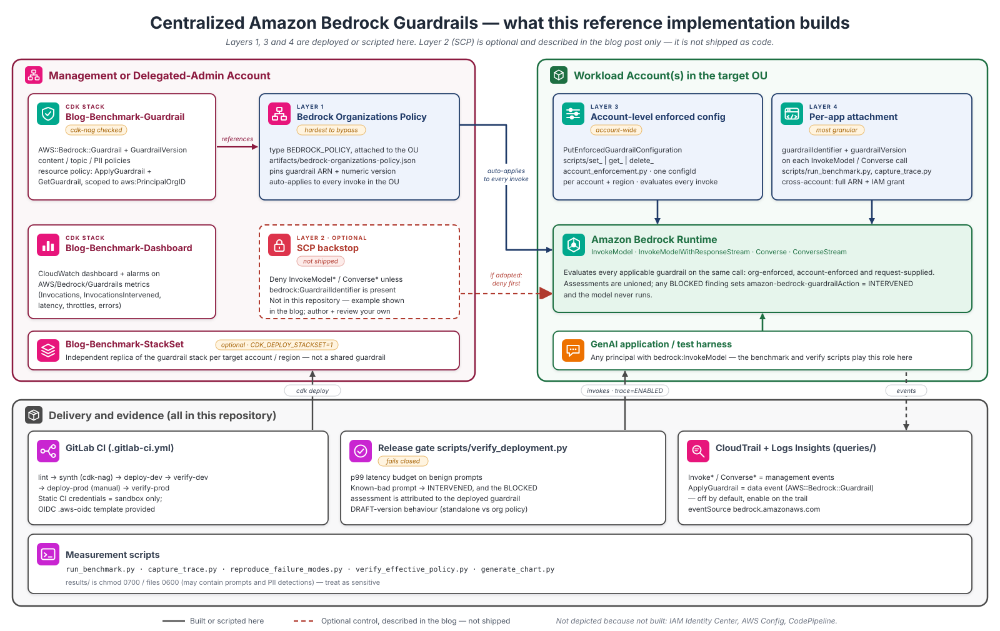

# Guardrails at Organization Scale — Centralized Amazon Bedrock Guardrails Enforcement

> **⚠️ Sample code — not production-ready as-is.** This repository is an
> educational reference implementation demonstrating patterns for enforcing
> Amazon Bedrock Guardrails across an AWS Organization. It has **not**
> completed a formal AWS AppSec security review. It deploys an AWS
> Organizations Bedrock policy and account-wide/cross-account resources. **Do not
> deploy this to a production AWS Organization without your own independent
> security review, threat model, and dependency audit.** See
> [SECURITY.md](SECURITY.md) for known limitations before you adapt this code.

A reference implementation demonstrating patterns for enforcing Amazon
Bedrock Guardrails across every account in an AWS Organization, using four
complementary enforcement layers. Every piece of code here is independently
deployable, typechecked, and covered by unit tests + CI.

This addresses the common security-scan finding: *"IAM roles with
`bedrock:InvokeModel*` and no guardrail enforcement"* found across
multi-account AWS Organizations.

---

## Architecture



The diagram shows only what this repository builds or documents, arranged in
three planes:

- **Management or delegated-admin account** — the three CDK stacks
  (`Blog-Benchmark-Guardrail`, `Blog-Benchmark-Dashboard`, and the optional
  `Blog-Benchmark-StackSet`) and **Layer 1**, the Bedrock Organizations
  policy that references the CDK-deployed guardrail and auto-applies it to
  every invoke in the OU. **Layer 2**, the SCP backstop, is drawn dashed
  and marked *not shipped*: it is optional, described in the blog post, and
  deliberately absent from this repository because it changes IAM
  authorization behaviour.
- **Workload account(s) in the target OU** — **Layer 3** (account-level
  enforced configuration, managed by the `*_account_enforcement.py`
  scripts) and **Layer 4** (per-app attachment on each call), both feeding
  the Bedrock Runtime, which evaluates every applicable guardrail on the
  same request and unions the assessments.
- **Delivery and evidence** — the GitLab CI pipeline, the
  `verify_deployment.py` release gate, the CloudTrail / Logs Insights
  queries, and the measurement scripts.

Layers 1, 3 and 4 are deployed or scripted here; Layer 2 is not. The layers
are **additive, not alternatives** — Bedrock evaluates every applicable
layer at request time and the most-restrictive intervention wins. Not
depicted because not built: IAM Identity Center, AWS Config, CodePipeline.

> **Before choosing which layers to adopt, read [SECURITY.md](SECURITY.md).**
> It documents the known limitations of each layer (what the SCP backstop
> does and does not prove, the two-sided cross-account permission model,
> the release-gate script's identity check, the CI credential posture), the
> accepted dependency risks, and the open items that still need a human
> security reviewer. Use it, together with [THREAT_MODEL.md](THREAT_MODEL.md),
> to decide which combination of layers fits your organization's risk
> tolerance rather than deploying all four by default.

### Layer 1 — Bedrock Organizations policy `(org plane)`

A native AWS Organizations policy of type `BEDROCK_POLICY`, attached at the
root or to specific OUs. The document references a versioned guardrail
ARN owned by the management account or a delegated administrator, and Bedrock
auto-applies it to every `InvokeModel` / `Converse` call across the targeted
member accounts. **Hardest layer to bypass** — workload teams cannot opt
out without removing the org attachment.

- **Artifact:** [`artifacts/bedrock-organizations-policy.json`](artifacts/bedrock-organizations-policy.json)
- **Validate effective inheritance with:** [`scripts/verify_effective_policy.py`](scripts/verify_effective_policy.py)
- **Caveat:** the referenced guardrail must be a numeric version (DRAFT is rejected) and must carry a resource-based policy granting `bedrock:ApplyGuardrail` to org members.
- **Cross-account permission is two-sided:** the resource-based policy on the guardrail (management-account side, attached automatically by `blog-guardrail-stack.ts` when `AWS_ORG_ID` is set) only grants the *resource* half. Member-account principals also need `bedrock:ApplyGuardrail` and `bedrock:GetGuardrail` in their own *identity*-side IAM policy, scoped to the guardrail's ARN. That identity-side policy is not shipped in this repo — an example is shown in the blog post; author and review your own. Missing this is a common source of `AccessDeniedException` even when the resource policy is correctly attached.

### Layer 2 — Service Control Policy `(org plane)`

A standard SCP that denies `bedrock:InvokeModel*` and `bedrock:Converse*`
unless the request includes a `bedrock:GuardrailIdentifier` condition key.
Belt-and-suspenders to Layer 1: catches direct-API calls that for any reason
fall outside the Bedrock Org policy's reach (e.g. brand-new regions, edge
service principals).

- **Artifact:** not shipped in this repository. Because an SCP changes IAM
  authorization behavior across your Organization, the example policy
  document is shown in the accompanying blog post only. Author, review, and
  test your own SCP with your security team before attaching it to any OU.
- **Known limitation to evaluate:** a `Null` condition on
  `bedrock:GuardrailIdentifier` proves *some* guardrail was attached, not the
  *approved* one. Layer 1 is the layer that pins to a specific guardrail ARN.

### Layer 3 — Account-level enforced guardrail configuration `(workload plane)`

Set via `bedrock:PutEnforcedGuardrailConfiguration`. When configured, every
`InvokeModel`/`Converse` call from the account is evaluated by the named
guardrail regardless of whether the caller attaches a `guardrailIdentifier`.
Acts as the per-account safety net for accounts that don't yet have an
org-level enforcement attached.

- **Set with:** [`scripts/set_account_enforcement.py`](scripts/set_account_enforcement.py) (`make enforce-set`)
- **Inspect with:** [`scripts/get_account_enforcement.py`](scripts/get_account_enforcement.py) (`make enforce-get`) — reads the `guardrailsConfig` array returned by `ListEnforcedGuardrailsConfiguration` and prints the `configId`, guardrail id/version/ARN and `modelEnforcement`; `-v` dumps the raw record.
- **Reverse with:** [`scripts/delete_account_enforcement.py`](scripts/delete_account_enforcement.py) (`make enforce-delete`) — `DeleteEnforcedGuardrailConfiguration` requires a `configId`; the script discovers it via the List call (or takes `--config-id` / `ENFORCED_CONFIG_ID`), shows it in the confirmation prompt, and exits 0 with "nothing to delete" when no configuration exists.
- **One configuration per account and region.** Both APIs are regional; run the scripts once per region you enforce in.

### Layer 4 — Per-app guardrail attachment `(workload plane)`

The application code itself sets `guardrailIdentifier` and
`guardrailVersion` on each `InvokeModel`/`Converse` call. Most granular
layer — gives application teams the ability to tighten beyond the org
baseline (additional denied topics, app-specific PII rules, custom word
filters).

- **Reference call pattern:** [`scripts/run_benchmark.py`](scripts/run_benchmark.py)
- **Trace inspection:** [`scripts/capture_trace.py`](scripts/capture_trace.py)

### How the layers compose

For a single `InvokeModel` request, Bedrock evaluates **all** layers that
apply (org policy, account-level config, caller-supplied guardrail) and
returns the union of `assessments`. If any one layer marks the input or
output as `BLOCKED`, the response is short-circuited and the
`amazon-bedrock-guardrailAction` field is set to `INTERVENED`.

---

## What's in this repo

```
.
├── README.md              ← you are here
├── Makefile                ← one-line tasks (install, test, deploy, bench, ...)
├── .gitlab-ci.yml          ← 6-stage pipeline with verify-as-gate
├── pyproject.toml          ← pytest + ruff config
├── requirements.txt        ← runtime deps (exact pins)
├── requirements-dev.txt    ← adds pytest + matplotlib (exact pins)
├── requirements*.lock      ← pip-compile lock files with hashes; what CI and `make install` actually install
├── images/
│   ├── bedrock-guardrails-architecture-v2.svg   ← canonical architecture diagram
│   ├── Bedrock-Guardrail-Flow.png               ← request lifecycle (when each layer fires)
│   └── Bedrock-Guardrail-Hierarchy.png          ← org / OU / account policy hierarchy
├── cdk/                     ← CDK app: guardrail, dashboard, StackSet
├── scripts/                 ← Python measurement + enforcement scripts
├── tests/                   ← pytest unit tests
├── artifacts/                ← static JSON policy documents
├── queries/                  ← CloudWatch Logs Insights queries
├── results/                  ← gitignored output of benchmark runs
└── tools/                    ← diagram generators (dev tooling, not deployed)
```

---

## CDK stacks

All TypeScript, all in `cdk/lib/`. Pinned to `aws-cdk-lib@2.275.0` (see `cdk/package.json`; transitive pins in its `overrides` block).
Verified by `npx jest` (10 tests) and `npx cdk synth` with cdk-nag in CI.

| Stack | File | What it does |
| --- | --- | --- |
| **`Blog-Benchmark-Guardrail`** | [`blog-guardrail-stack.ts`](cdk/lib/blog-guardrail-stack.ts) | Deploys an `AWS::Bedrock::Guardrail` (content filters, denied topic, PII rules) plus an `AWS::Bedrock::GuardrailVersion`. When `AWS_ORG_ID` is set, additionally attaches a resource-based policy via `AwsCustomResource` calling `bedrock:PutResourcePolicy` so org members can `bedrock:ApplyGuardrail`. |
| **`Blog-Benchmark-Dashboard`** | [`blog-dashboard-stack.ts`](cdk/lib/blog-dashboard-stack.ts) | CloudWatch dashboard sourced from the documented `AWS/Bedrock/Guardrails` namespace. Widgets: invocations vs interventions, p50/p99 latency, errors and throttles. Includes two alarms (throttle, sustained server error). |
| **`Blog-Benchmark-StackSet`** | [`blog-stackset-stack.ts`](cdk/lib/blog-stackset-stack.ts) | Multi-region, multi-account `AWS::CloudFormation::StackSet` that deploys an **independent replica** of the guardrail stack into every target account/region (identical configuration, separate resources — not a shared central guardrail; see the "Known limitation" note in [SECURITY.md](SECURITY.md)). Off by default; opt in with `CDK_DEPLOY_STACKSET=1`. |
| (cross-cutting) `tagging.ts` | [`tagging.ts`](cdk/lib/tagging.ts) | Applies standard `Project / Environment / Owner / ManagedBy / CostCenter` tags to every taggable construct via Aspects. |

---

## Python scripts

Live under `scripts/`. Shared lib (`_lib/`) factors out config loading,
structured logging, percentile math, and the assessment parser. Unit tests
in `tests/` cover the pure functions.

| Script | What it does | Output |
| --- | --- | --- |
| **`run_benchmark.py`** | 3 scenarios × 100 InvokeModel calls (no guardrail / attached + benign / attached + intervened). Wall-clock latency + token counts + intervention count. | `results/benchmark_<ts>.csv`, `results/summary_<ts>.json` |
| **`capture_trace.py`** | One InvokeModel with `trace=ENABLED` against a known-bad prompt. Dumps the full `assessments` JSON. | `results/trace_<ts>.json` |
| **`verify_effective_policy.py`** | `organizations:DescribeEffectivePolicy` for `BEDROCK_POLICY`. Echoes the inheritance chain. | `results/effective_policy_<ts>.json` |
| **`reproduce_failure_modes.py`** | Forces 4 documented failure modes (DRAFT guardrail, cross-region attach, missing version, ResourceNotFound on Apply). Captures exact error codes. | `results/failure_modes_<ts>.log` |
| **`verify_deployment.py`** | Release-gate assertions against a deployed guardrail: latency budget; intervention attributed to the deployed guardrail's id/ARN + version (fails closed when identity cannot be proven); DRAFT behavior. | `results/verify_<ts>.json` |
| **`set_account_enforcement.py`** | Sets the account-level enforced guardrail configuration (Layer 3). | — |
| **`get_account_enforcement.py`** | Shows the current account-level enforced guardrail configuration (Layer 3) from `ListEnforcedGuardrailsConfiguration.guardrailsConfig`, including its `configId`. | — |
| **`delete_account_enforcement.py`** | Removes the account-level enforced guardrail configuration (Layer 3). Discovers the required `configId` (or takes `--config-id`) and confirms before deleting. | — |
| **`generate_chart.py`** | Renders a latency-distribution histogram from the latest benchmark CSV. | `results/benchmark_<ts>.png` |

All scripts share the same CLI shape — `--guardrail-id`, `--guardrail-version`, `--region`, `--results-dir`, `-v` — and fall back to environment variables.

---

## Attaching a guardrail — two options

There are two ways to make a guardrail apply to an individual workload. They
use different APIs and have different trust models.

### Option A — Per-application attachment (Layer 4)

The application passes `guardrailIdentifier` + `guardrailVersion` on every
`InvokeModel` / `Converse` call. The guardrail fires only when the caller
opts in. See `scripts/run_benchmark.py` (the `invoke` function) and
`scripts/capture_trace.py` for the exact call shape:

```python
client.invoke_model(
    modelId=model_id,
    body=body,
    guardrailIdentifier=gid,     # both fields required together
    guardrailVersion=gver,       # numeric version, never DRAFT
)
```

- **Owner:** application team.
- **Strength:** each app chooses and tightens its own guardrail.
- **Weakness:** an app can simply omit the identifier — which is why the
  SCP (Layer 2) exists as a backstop.

### Option B — Account-level enforced configuration (Layer 3)

The account owner sets one guardrail that Bedrock applies to **every**
`InvokeModel` / `Converse` call in the account and region, regardless of
whether the caller attaches anything. Managed by three scripts:

```bash
# Set — enforce on all models except embeddings
make enforce-set   # or: python scripts/set_account_enforcement.py \
                   #        --guardrail-id <ID> --guardrail-version <V> \
                   #        --region <REGION> \
                   #        --exclude-models amazon.titan-embed-text-v2:0

make enforce-get      # show what is currently enforced
make enforce-delete   # remove the account-level enforcement
```

- **Owner:** account owner / platform team.
- **Strength:** covers calls that pass no guardrail identifier at all.
- **Weakness:** must be set per account (or automated); if neither this nor
  an org policy is set, there is no enforcement.

Under the hood, Option B (`bedrock:PutEnforcedGuardrailConfiguration`) uses
the same `modelEnforcement` / `guardrailInferenceConfig` shape as the
org-level Bedrock policy in `artifacts/bedrock-organizations-policy.json` —
the org policy is essentially Option B applied top-down to every account in
an OU.

---

## Static artifacts (not deployed by CDK)

| File | Applied by | Caller |
| --- | --- | --- |
| [`artifacts/bedrock-organizations-policy.json`](artifacts/bedrock-organizations-policy.json) | `aws organizations create-policy --type BEDROCK_POLICY` | Management account or delegated admin |
| [`queries/cloudwatch_logs_insights.txt`](queries/cloudwatch_logs_insights.txt) | CloudWatch Logs Insights | Anyone with read access to CloudTrail logs. Invoke/Converse calls are management events; the intervention query needs the `ApplyGuardrail` **data event** (`AWS::Bedrock::Guardrail`) enabled on the trail — see [SECURITY.md](SECURITY.md). |

These are deliberately external to the CDK app because each one is applied
by a different AWS service and a different caller (Organizations, not
CloudFormation).

The SCP (Layer 2) and the member-account `ApplyGuardrail` IAM policy are
**not** included as files. Both change authorization behavior in your
Organization; the blog post shows example documents for reference, and you
should author, review, and test your own before applying them.

---

## Quickstart

```bash
# One-time install (creates .venv and installs python deps)
make install

# Verify everything green before deploying
make test         # pytest + cdk jest + cdk synth

# Deploy single-region guardrail + dashboard
make deploy

# Capture data
export GUARDRAIL_ID=<from CDK output>
export GUARDRAIL_VERSION=<from CDK output>
make bench        # ≈ 5 min, ≈ $0.05–$0.10
make trace
make failures
make chart        # latency histogram from latest CSV

# Tear down when done
make destroy
```

### Configuration

Every script accepts CLI flags and falls back to environment variables in
this order: `--flag` → env → default.

| Flag | Env | Default |
| --- | --- | --- |
| `--guardrail-id` | `GUARDRAIL_ID` | (required) |
| `--guardrail-version` | `GUARDRAIL_VERSION` | (required) |
| `--region` | `AWS_REGION` | `us-east-1` |
| `--model-id` | `MODEL_ID` | `anthropic.claude-3-haiku-20240307-v1:0` |
| `--results-dir` | `RESULTS_DIR` | `results/` |
| `--iterations` (benchmark only) | `ITERATIONS` | `100` |
| `--concurrency` (benchmark only) | `CONCURRENCY` | `4` |
| `-v` / `--verbose` | `BLOG_DEBUG` | off |

CDK environment variables:

| Env | Effect |
| --- | --- |
| `AWS_ORG_ID` | Set to `o-xxxxxxxxxx` to attach the guardrail's resource-based policy granting org members `bedrock:ApplyGuardrail`. Required for org-level enforcement. |
| `CDK_DEPLOY_STACKSET=1` | Include the multi-region StackSet stack in `cdk deploy --all`. Off by default — that stack only makes sense from the management / delegated-admin account. |
| `CDK_TARGET_REGIONS` | Comma-separated regions for the StackSet (default `us-east-1,us-west-2`) |
| `CDK_TARGETS` | OU IDs (SERVICE_MANAGED) or account IDs (SELF_MANAGED) |
| `CDK_PERMISSION_MODEL` | `SERVICE_MANAGED` (default) or `SELF_MANAGED` |
| `ENVIRONMENT`, `OWNER`, `COST_CENTER` | Standard tags applied to every stack |

### What gets deployed

| Stack | Purpose | Default? |
| --- | --- | --- |
| `Blog-Benchmark-Guardrail` | Guardrail v1 + (optional) resource policy | Yes |
| `Blog-Benchmark-Dashboard` | CloudWatch dashboard + 2 alarms | Yes |
| `Blog-Benchmark-StackSet` | Multi-region StackSet template | Only when `CDK_DEPLOY_STACKSET=1` |

All resources carry the `Project=bedrock-guardrails-blog` tag plus
environment / owner / cost-center tags.

### Cost

A full `make bench` run is ≈ 300 InvokeModel calls against Claude 3 Haiku,
≈ \$0.05–\$0.10 depending on token usage. The dashboard and guardrail
themselves carry no per-hour cost.

---

## CI/CD with runtime test as release gate

[`.gitlab-ci.yml`](.gitlab-ci.yml) implements a 6-stage pipeline:

```
lint  →  synth  →  deploy-dev  →  verify-dev  →  deploy-prod (manual)  →  verify-prod
```

The differentiator is `verify-dev` and `verify-prod`. After `cdk deploy`
finishes, the verify stage runs [`scripts/verify_deployment.py`](scripts/verify_deployment.py)
against the *deployed* guardrail. The script asserts:

1. **Latency budget** — p99 for benign invocations under `VERIFY_P99_MS` (default 3000 ms)
2. **Intervention, attributed to the deployed guardrail** — a known-bad prompt returns `amazon-bedrock-guardrailAction == "INTERVENED"`, **and** the assessment carrying the `BLOCKED` finding is attributed (via `appliedGuardrailDetails` id/ARN and version) to the guardrail this release deployed. A different guardrail blocking while the deployed one is merely in scope **fails** the gate. A blocking assessment with no `appliedGuardrailDetails` also fails by default; set `VERIFY_ALLOW_UNCONFIRMED_IDENTITY=1` to accept it as PASS with `identity_confirmed: false` in the report. Both trace layouts (direct model IDs and inference profiles) are parsed.
3. **DRAFT behaviour** — invokes with `guardrailVersion=DRAFT` raise `ValidationException` (or, if an org policy is active, the org guardrail takes over and the call succeeds — both are treated as PASS)

A failed assertion fails the pipeline; the next stage does not run. This
makes the guardrail's *runtime behaviour* part of the release gate, not
just its IaC syntax.

**Pipeline credentials.** As written, the deploy and verify jobs read
static `DEV_AWS_*` / `PROD_AWS_*` keys from GitLab CI/CD variables. That is
**sandbox-only**. For any account that matters, delete those variables and
use the commented `.aws-oidc` job template in `.gitlab-ci.yml`
(`id_tokens:` + `sts assume-role-with-web-identity`) so each stage assumes
a scoped IAM role with no long-lived key — see
[SECURITY.md](SECURITY.md) for the AWS-side prerequisites.

The unit tests in [`tests/test_verify_deployment.py`](tests/test_verify_deployment.py)
cover the assertion logic with mocked Bedrock responses, so the gate
itself is testable without AWS credentials.

---

## Dev tooling

[`tools/`](tools/) contains the matplotlib generators for the flow and
hierarchy diagrams in `images/`, plus the generator that produced the
layout the canonical architecture SVG was finished from. Not part of the
deployable sample — see [`tools/README.md`](tools/README.md) if you want to
regenerate or tweak a diagram. If you change what the repository builds,
update `images/bedrock-guardrails-architecture-v2.svg` in the same change
so the diagram cannot drift from the code.

---

## Security

See [SECURITY.md](SECURITY.md) for known limitations, and
[CONTRIBUTING.md](CONTRIBUTING.md#security-issue-notifications) for how to
report a security issue, and [THREAT_MODEL.md](THREAT_MODEL.md) for the (draft,
unreviewed) threat model. This code has not completed a formal AWS AppSec
review — see the disclaimer at the top of this README.

`cdk-nag`'s AWS Solutions rule pack runs automatically on every
`cdk synth` (see `cdk/bin/app.ts`) and is enforced in CI. Run `make nag` to
check locally; it fails with a non-zero exit code on any unsuppressed
finding. `cdk/npm-audit-report.txt` has the current `npm audit` evidence
for the CDK app's dependencies (Critical/High: 0; the remaining
Moderate/Low advisories, where they live and why each is unpatched, are
tabled in [SECURITY.md](SECURITY.md)). Python dependencies are exact-pinned
and installed from hash-locked `requirements*.lock` files by both
`make install` and CI.

**CloudTrail.** `InvokeModel`, `InvokeModelWithResponseStream`, `Converse`
and `ConverseStream` are logged as **management** events. What a guardrail
*decided* is in the `ApplyGuardrail` **data** event (resource type
`AWS::Bedrock::Guardrail`), which is off by default and must be enabled on
the trail before the intervention query in
[`queries/cloudwatch_logs_insights.txt`](queries/cloudwatch_logs_insights.txt)
returns anything. All of these carry `eventSource = bedrock.amazonaws.com`.

## License

This project is licensed under the MIT-0 License. See [LICENSE](LICENSE).
